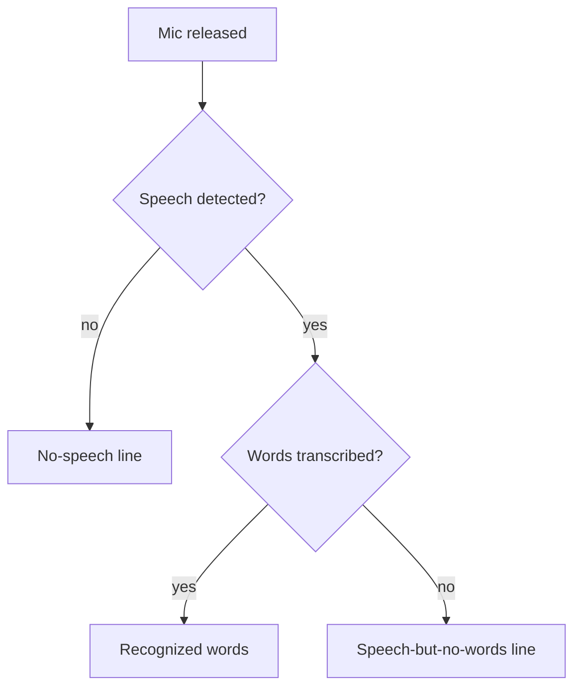
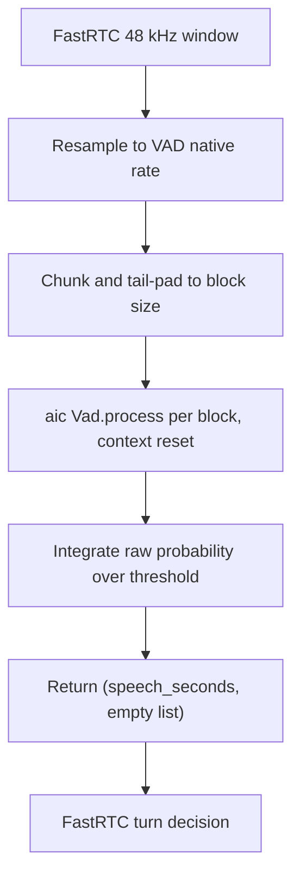
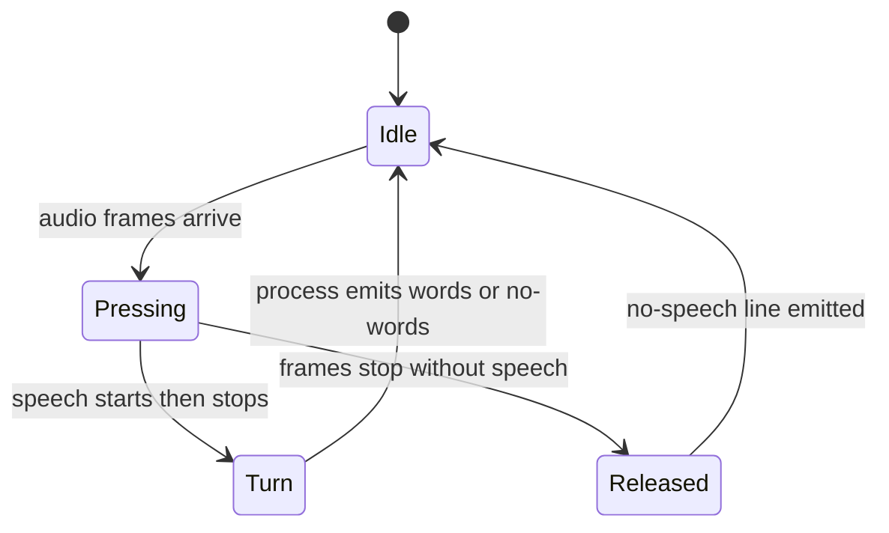

# ai-coustics VAD Turn Detection - Plan

> **Superseded (2026-09-27).** This plan shipped turn-based pause detection with
> `ReplyOnPause` + `AICVadAdapter`; Purr has since moved to continuous streaming
> transcription and that machinery was removed. Kept as a historical record.

## Goal Capsule

- **Objective:** Replace FastRTC's default Silero pause detector with ai-coustics' `Vad`, and use that VAD's verdict to make the transcript's silence reporting honest.
- **Product authority:** The Purr maintainer set the direction — one ai-coustics stack — in the source brainstorm.
- **Open blockers:** None.
- **Stop conditions:** Stop and ask if the release-event binding for the speechless-press path cannot be verified and the timeout fallback would change turn behavior for normal speech.
- **Execution profile:** Code.

---

## Product Contract

### Summary

ai-coustics' `Vad` becomes the pause detector behind FastRTC's detector interface, so aic owns when an utterance ends. The VAD verdict then sharpens how the transcript reports silence: "speech was heard but no words came back" reads differently from "no speech detected", and a speechless press produces a line instead of nothing.

### Problem Frame

Purr presents itself as an ai-coustics showcase: enhancement is aic's Quail. Turn detection, though, is FastRTC's default Silero model — a second, unrelated detector, fetched from the Hub and run through onnxruntime, that the app never names. That undercuts the one-stack story and leaves a dependency the demo does not mean to advertise.

Separately, the transcript's silence handling is coarse. The only no-speech label fires when Whisper returns empty text, which is really a transcription miss once FastRTC has already detected speech. And because `ReplyOnPause` never fires a turn without speech, a press-and-release in silence produces no output at all.

### Key Decisions

- **ai-coustics' `Vad` is the pause detector, sitting behind FastRTC's detector interface.** aic owns turn detection without discarding FastRTC's turn machine. Governs R1, R2.
- **Keep FastRTC's turn state machine rather than rewrite turn-taking.** Reimplementing interruption and the continuous-speech cap is the largest regression risk and is not needed for this goal. Governs R2.
- **Visibility is a transcript label, not a live indicator or a per-utterance readout.** It shows aic's VAD is doing real work without new UI machinery. Governs R3, R4.
- **Drop the Silero dependency trail rather than just stop using it.** Leaving `onnxruntime` installed keeps the second VAD stack in the image. Governs R6.

### Requirements

**Turn detection**
- R1. ai-coustics' `Vad` is the pause detector for every session; the Silero checkpoint is no longer downloaded or loaded.
- R2. Existing turn behavior is preserved: utterance boundaries, playback during a reply, interruption, the continuous-speech cap, and transcript append all behave as they do today.

**Silence reporting**
- R3. When a turn fires and the VAD confirms speech but transcription returns no words, the transcript reports that case distinctly from a no-speech case.
- R4. A press-and-release during which the VAD detects no speech produces a no-speech transcript line instead of nothing.

**Startup and secrets**
- R5. Importing the app and constructing the UI still succeed with neither `HF_TOKEN` nor `AIC_SDK_LICENSE` set; the aic VAD is constructed only when a session needs it.

**Dependencies**
- R6. Silero's dependency trail is removed: fastrtc is installed without the `vad` extra and `onnxruntime` is no longer in the lock.

### Key Flows

- F1. Speech utterance
  - **Trigger:** the user holds the mic, speaks, and releases.
  - **Steps:** the VAD detects speech and ends the turn; the utterance is enhanced per mode, played back, and transcribed.
  - **Outcome:** the transcript gains the recognized words.
  - **Covered by:** R1, R2.
- F2. Speechless press
  - **Trigger:** the user holds the mic, stays silent, and releases.
  - **Steps:** the VAD never confirms speech.
  - **Outcome:** the transcript gains a no-speech line; no transcription request is made.
  - **Covered by:** R4.
- F3. Speech with empty transcription
  - **Trigger:** the user speaks and releases, and the VAD confirms speech.
  - **Steps:** transcription returns no words.
  - **Outcome:** the transcript reports speech-present/no-words, not no-speech.
  - **Covered by:** R3.

### Acceptance Examples

- AE1. Speechless press reports no speech
  - **Covers R4.**
  - **Given** captured audio in which the VAD detects no speech,
  - **When** the user releases the mic,
  - **Then** the transcript gains a no-speech line and no transcription call is made.
- AE2. Speech with no words is not "no speech"
  - **Covers R3.**
  - **Given** a turn the VAD confirmed as speech and a transcription that returned empty,
  - **When** the turn completes,
  - **Then** the transcript reports speech-present/no-words, distinct from the no-speech line.
- AE3. Startup without a license
  - **Covers R5.**
  - **Given** `AIC_SDK_LICENSE` is unset,
  - **When** the app is imported and the UI constructed,
  - **Then** startup succeeds, and the VAD failure surfaces only when a session asks for detection.
- AE4. Normal speech is unchanged
  - **Covers R2.**
  - **Given** the VAD confirms speech and transcription returns words,
  - **When** the turn completes,
  - **Then** enhanced/raw mode, playback, interruption, and transcript append behave as they do today.

### Success Criteria

- No Silero checkpoint is fetched or loaded at runtime.
- `python smoke_test.py` still passes, including UI construction with no secrets set.
- The three outcomes — recognized words, speech-but-no-words, no speech — are distinguishable in the transcript.
- `onnxruntime` and fastrtc's `vad` extra are gone from the dependency lock.
- A spoken utterance still completes end-to-end on Spaces within the existing `time_limit`.

### Scope Boundaries

- A live speech indicator and a per-utterance VAD verdict readout are deferred.
- Replacing `ReplyOnPause` entirely, so aic owns turn-taking, is deferred.
- Enhancement and transcription behavior is unchanged.

### Dependencies

- aic-sdk 3.2.0 provides the `Vad` API; its dedicated VAD model is a separate download, usable under the existing `AIC_SDK_LICENSE`.
- FastRTC's detector contract is `vad(audio, options) → (speech_seconds, chunks)` plus `warmup()`, consumed by `ReplyOnPause`.

### Sources / Research

- Detector contract consumed by the app: `.venv/Lib/site-packages/fastrtc/pause_detection/protocol.py`, `.venv/Lib/site-packages/fastrtc/reply_on_pause.py`.
- Silero loader being replaced: `.venv/Lib/site-packages/fastrtc/pause_detection/silero.py`.
- aic VAD API: `.venv/Lib/site-packages/aic_sdk/__init__.pyi`.
- App and invariants: `app.py`, `pyproject.toml`, `AGENTS.md`, `README.md`.

---

## Planning Contract

Product Contract preservation: unchanged — the two deferred planning questions are resolved in place, and no R/F/AE changed.

### Key Technical Decisions

- KTD1. **Wrap aic's detector in FastRTC's `PauseDetectionModel` adapter.** The adapter exposes `vad()` and `warmup()`, so FastRTC's turn machine is untouched. Governs R1.
- KTD2. **Process one ~0.6 s window per call at the model's native rate.** Resample the incoming 48 kHz window to the VAD model's native rate, chunk it to the model's block size, tail-pad the final block, and reset the detector context per window. Governs R1.
- KTD3. **Derive the window's speech-seconds by integrating raw probability.** Threshold `raw_vad_probability()` per block; `is_speech_detected()` carries hold hysteresis that would mask pauses. Governs R1, R2.
- KTD4. **Give every connection its own detector; cache the aic model process-wide.** Override the handler's copy path to build a fresh detector per connection, and cache the downloaded model behind the existing init lock. Prevents cross-session verdict corruption at `concurrency_limit=5`. Governs R1, R2.
- KTD5. **Drive the speechless-press signal from the UI release event; a handler no-input timeout is the fallback.** The component exposes a release event the audio UI does not currently bind; bind it and synthesize a no-speech turn only when no turn fired during that press. Governs R2, R4.
- KTD6. **Fail closed when the detector is unavailable.** Catch adapter exceptions and return the never-ending sentinel, so a license or init failure yields no turns rather than spurious ones. Governs R1, R2, R5.
- KTD7. **Remove the Silero dependency trail in the same change that wires the adapter.** Drop the `vad` extra and regenerate the lock; otherwise the default-detector import raises at startup. Governs R6.

### High-Level Technical Design

### Risks & Dependencies

- The release-event binding for R4 is unverified; a real-browser press-and-release gates it, and the timeout fallback applies if the event is unusable.
- The aic VAD needs a license and its own model download; runtime failure degrades to "never ends a turn" (KTD6) rather than a surfaced error.
- Resample-and-threshold work sits in the turn path; pause timing must stay close to today's behavior (R2).
- The adapter wiring and the dependency drop must land together (KTD7).

---

## Implementation Units

### U1. aic VAD detector adapter

- **Goal:** Add an adapter that satisfies FastRTC's pause-detection contract and builds the aic VAD lazily.
- **Requirements:** R1, R2, R5.
- **Dependencies:** None.
- **Files:** `app.py`, `smoke_test.py`.
- **Approach:**
  1. Define an adapter with `vad(audio, options)` and `warmup()`, keeping its constructor free of secrets and network access.
  2. Build the aic VAD model lazily and cache it process-wide behind the existing init lock, mirroring the Quail loader.
  3. On each `vad()` call, apply KTD2 window handling, then KTD3 probability integration.
  4. Apply KTD4 per-connection detector construction and KTD6 fail-closed handling.
- **Patterns to follow:** `load_quail` and `enhance_16k` in `app.py` for the lazy singleton, lock, block padding, and per-call reset.
- **Test scenarios:**
  - Happy path: with a license, a window containing speech returns a positive speech-seconds value; a silent window returns zero. (Requires secrets.)
  - Edge: a window whose length is not a multiple of the block size is padded and does not raise a config-mismatch error.
  - Edge: a 48 kHz input window is accepted and internally resampled to the model's native rate.
  - Error: with no license set, building the app does not raise; the failure occurs only when a detector is built.
  - Integration: the adapter satisfies the detector contract and returns a float plus a list.
- **Test expectation:** none for the aic-dependent cases at unit level — the repo has no unit-test harness and the model needs a license; verify those through the gated manual run in the Verification Contract, and cover the secret-free cases in `smoke_test.py`.
- **Verification:** `python smoke_test.py` passes; a licensed run returns plausible speech-seconds for speech and silence.

### U2. Wire the adapter and drop the Silero dependency trail

- **Goal:** Make aic the detector and remove `onnxruntime` plus fastrtc's `vad` extra in one atomic change.
- **Requirements:** R1, R2, R5, R6.
- **Dependencies:** U1.
- **Files:** `app.py`, `pyproject.toml`, `requirements.txt`, `smoke_test.py`.
- **Approach:**
  1. Pass the adapter instance as the handler's `model`, ensuring it is truthy so the default detector is never constructed.
  2. Change the fastrtc dependency to drop the `vad` extra.
  3. Regenerate the lock with the documented uv command; do not hand-edit it.
  4. Leave the Gradio pin, the `sdk_version` coupling, and the ZeroGPU probe binding intact.
- **Patterns to follow:** `app.py`'s `Stream` wiring and unit `ReplyOnPause(process)` construction; `AGENTS.md` for the pin and ZeroGPU invariants.
- **Test scenarios:**
  - Happy path: importing the app with no secrets set still constructs the UI and never constructs Silero.
  - Edge: the lock no longer contains `onnxruntime` after regeneration.
  - Error: with the extra dropped but no adapter passed, import fails — the regression the atomic change prevents.
  - Integration: the ZeroGPU startup probe remains bound to a UI event.
- **Execution note:** Land the wiring and the dependency edit together and verify with a smoke-first install.
- **Verification:** `python smoke_test.py` passes; the lock has no `onnxruntime`; importing the app raises no missing-detector error.

### U3. Speechless-press no-speech output

- **Goal:** A press with no detected speech yields a no-speech transcript line without invoking transcription.
- **Requirements:** R4, R2.
- **Dependencies:** U2.
- **Files:** `app.py`, `smoke_test.py`.
- **Approach:**
  1. Subclass the pause handler to track press activity and to synthesize a speechless turn only when no turn fired during that press (KTD5).
  2. Bind the release event inside the stream UI to dispatch to the connection's handler.
  3. Give the speechless path its own output that appends one bare no-speech line and skips enhancement, playback, and transcription.
  4. Keep the existing transcript-append form and the single bare-value output contract.
- **Patterns to follow:** the `_zerogpu_startup_probe` UI binding for `with stream.ui:`; `process()` for the transcript-append form.
- **Test scenarios:**
  - Covers AE1. A silent hold-and-release appends exactly one no-speech line and makes no transcription call.
  - Edge: a hold that already fired a spoken turn appends nothing extra on release (no double append).
  - Edge: release-event payload and inputs are confirmed in a real browser; if unusable, the timeout fallback produces the same line.
  - Error: a release event for an unknown connection is a no-op.
- **Execution note:** Browser-verify the release-event binding before relying on it; implement the timeout fallback if it fails.
- **Verification:** a browser press-and-release with silence shows the no-speech line and no transcription error.

### U4. Speech-with-no-words label

- **Goal:** When a fired turn yields no words, label it distinctly from a speechless press.
- **Requirements:** R3, R1.
- **Dependencies:** U2.
- **Files:** `app.py`, `smoke_test.py`.
- **Approach:**
  1. Relabel the empty-transcription branch to the speech-with-no-words wording.
  2. Do not add a second VAD pass: a fired turn already implies VAD-confirmed speech.
  3. Keep the output a single bare value.
- **Patterns to follow:** the existing empty-transcription branch and transcript-append form in `process()`; the label vocabulary in `CONCEPTS.md`.
- **Test scenarios:**
  - Covers AE2. An empty transcription on a fired turn produces the speech-with-no-words line, distinct from the no-speech line.
  - Covers AE4. A non-empty transcription is unchanged.
  - Edge: the label helper returns a single string for the output component.
- **Verification:** `python smoke_test.py` passes; a licensed run shows the two labels distinctly.

---

## Verification Contract

| Gate | Command or check | Applies to |
|---|---|---|
| Smoke test | `python smoke_test.py` | All units |
| No Silero lock entry | search `requirements.txt` for `onnxruntime` returns nothing | U2, R6 |
| No-secrets startup | smoke test case that constructs the UI with `HF_TOKEN` and `AIC_SDK_LICENSE` unset | U1, U2, R5 |
| Licensed behavior | `python app.py` with both secrets set; speak, then press-and-release silently | U1, U3, U4 |
| Release-event binding | browser press-and-release confirms the no-speech line fires | U3, R4 |
| ZeroGPU probe binding | structural check that the probe click is still inside the stream UI | U2 |

There is no test framework, lint, or typecheck in this repo; `python smoke_test.py` is the only automated gate and the remaining checks are manual or gated on secrets.

---

## Definition of Done

- All four units are complete and the plan's Requirements are satisfied.
- `python smoke_test.py` passes, including the no-secrets UI-construction case.
- `onnxruntime` and fastrtc's `vad` extra are absent from the lock.
- No Silero checkpoint is fetched or loaded at runtime.
- A licensed run distinguishes recognized words, speech-but-no-words, and no-speech outcomes.
- A browser press-and-release in silence produces the no-speech line, and a spoken turn is unchanged.
- The ZeroGPU startup probe remains bound.
- Abandoned or experimental code from approaches that did not pan out is removed from the diff.
