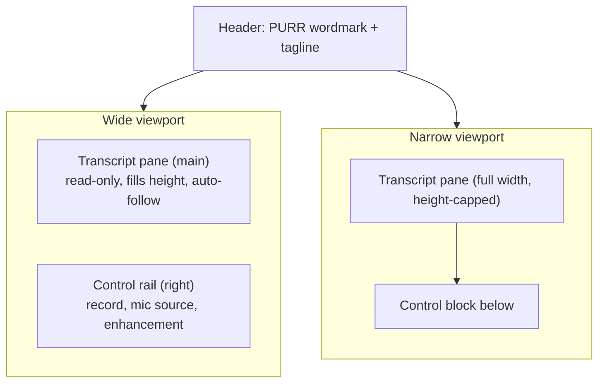
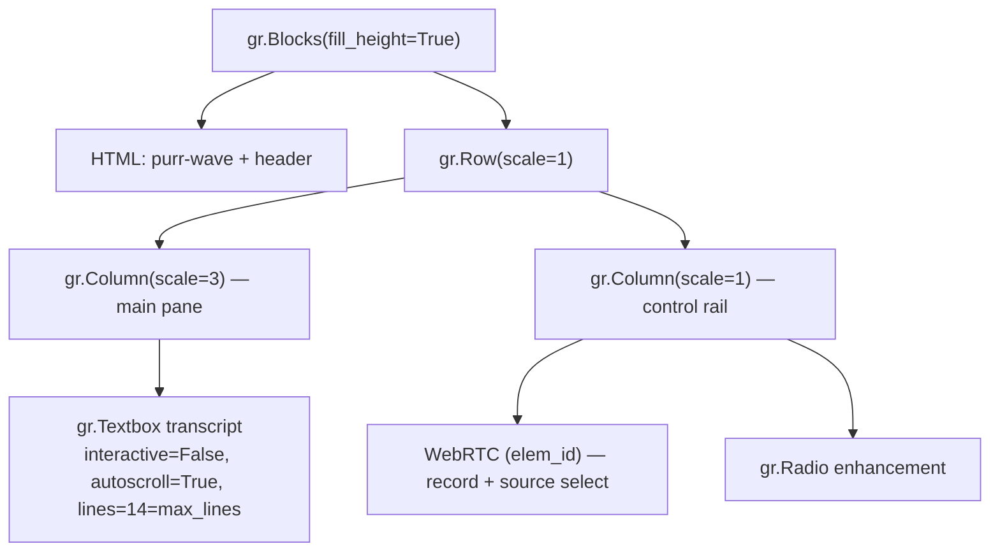

# PURR UI Control-Rail Layout - Plan

## Goal Capsule

- **Objective:** Rearrange the PURR page into a right-side control rail beside a transcript pane that fills the viewport, present the microphone-source picker as its own control, and reflow the rail below the transcript on narrow screens.
- **Product authority:** Layout and interaction decisions come from the Product Contract below. No adjacent product area is active scope.
- **Execution profile:** One file of production change (`app.py`) plus regression coverage in `smoke_test.py`. No dependency or pin changes.
- **Stop conditions:** Stop and report if a separate source picker requires adding a new Gradio control, or if the full-height layout cannot be achieved within the pinned `gradio==5.50.0` / `fastrtc==0.0.34`.
- **Product Contract preservation:** Unchanged except: R13 added (narrow-screen transcript cap); the auto-follow assumption corrected (Gradio's built-in `autoscroll` replaces the planned JS hook) and both outstanding questions resolved. No requirement was weakened or removed.

---

## Product Contract

### Summary

PURR becomes a two-region page: a right control rail holding the record control, the microphone-source picker, and the Quail enhancement selector, beside a transcript pane that fills the remaining height and follows the newest line. The page stops scrolling at desktop sizes; on narrow screens the rail drops below the transcript.

### Problem Frame

The current UI stacks three blocks in one column: the header, a transcript box fixed at about 46vh, and a control row with a 168px mic panel. On ordinary desktop windows that stack is taller than the viewport, so the page scrolls and the transcript gets less room than the screen allows. The microphone-source picker is also embedded in the record control as an arrow-triggered dropdown, so it reads as part of the record button rather than as a separate setting.

### Key Decisions

- **Right control rail over a left rail or a bottom control bar.** (session-settled: user-directed — chosen over a left rail and a bottom bar: the transcript keeps the natural left reading position and the controls stay reachable.) Governs R1, R2, R5, R6.
- **Reuse FastRTC's own source selector, restyled into a standalone control, over building a replacement.** (session-settled: user-directed — chosen over removing the picker altogether: device choice is worth keeping.) Governs R10, R11.
- **Transcript fills its pane and auto-follows, over a fixed-height box.** (session-settled: user-directed — chosen over keeping a fixed ~14-line box: removing the page scroll is the point of the change.) Governs R8, R9.
- **Keep the transcript as Gradio's read-only text box.** Governs R7.

### Requirements

**Layout and responsiveness**

- R1. The desktop page renders two regions side by side: a right control rail and a main transcript pane, with the transcript pane as the dominant region.
- R2. The control rail holds exactly the record control, the microphone-source control, and the enhancement selector.
- R3. The transcript pane fills the viewport height beneath the header, so the page does not scroll at typical desktop window sizes.
- R4. The enhancement selector keeps its current value semantics and stays the value the streaming handler reads to choose enhanced versus raw.
- R5. The header (PURR wordmark and tagline) stays above both regions.
- R6. Below a 768px viewport width, the rail renders as a control block below the transcript, and the transcript keeps the full width.
- R13. Below the same breakpoint, the transcript pane is height-capped so the control block stays reachable without scrolling through a full transcript. Page scroll is acceptable there.

**Transcript**

- R7. The transcript stays read-only: users cannot type into it.
- R8. The transcript box fills the available height of the main pane instead of a fixed line count.
- R9. While text streams in, the newest line stays in view without user action, and auto-follow pauses while the user has scrolled up.

**Microphone source**

- R10. The microphone-source picker renders as a control visually distinct from the record button.
- R11. The picker offers the user's real input devices, and the device it reports is the one FastRTC streams from.

**Preserved behavior**

- R12. Streaming transcription, partial and commit handling, enhancement fallback, error surfacing, the ZeroGPU startup probe binding, and the transcript replace handler behave exactly as today.

### Key Flows

- F1. Desktop first render
  - **Trigger:** A visitor loads the page in a wide viewport.
  - **Steps:** The header renders; the transcript pane fills the height; the rail renders to its right with the record, source, and enhancement controls.
  - **Outcome:** No page scrollbar, and the transcript is the largest region.
  - **Covers:** R1, R2, R3, R5.
- F2. Speaking with auto-follow
  - **Trigger:** Visitor starts recording and speaks.
  - **Steps:** Text arrives in the transcript and the newest line stays visible; if the visitor scrolls up, following pauses.
  - **Outcome:** The live transcript is readable without scrolling.
  - **Covers:** R8, R9, R12.
- F3. Changing microphone source
  - **Trigger:** Visitor picks a different input device from the source control.
  - **Steps:** The stream uses the selected device.
  - **Outcome:** Transcription follows the chosen microphone.
  - **Covers:** R10, R11.
- F4. Narrow viewport
  - **Trigger:** Viewport narrows past the breakpoint.
  - **Steps:** The rail moves below the transcript and the transcript height is capped.
  - **Outcome:** The transcript spans the width and the controls stay reachable.
  - **Covers:** R6, R13.
- F5. Viewport crosses the breakpoint mid-session
  - **Trigger:** The visitor resizes the window across the breakpoint while recording.
  - **Steps:** The layout reflows; the stream and transcript are untouched.
  - **Outcome:** Recording and the transcript continue uninterrupted.
  - **Covers:** R6, R12.

### Acceptance Examples

- AE1. Desktop height
  - **Given:** a desktop window at the target size.
  - **When:** the page loads with an empty transcript.
  - **Then:** the page does not scroll and the record and enhancement controls are visible without scrolling.
  - **Covers:** R1, R3, R5.
- AE2. Auto-follow under a full transcript
  - **Given:** the transcript already overflows its pane.
  - **When:** a new line commits.
  - **Then:** the newest line is visible without user action.
  - **Covers:** R9.
- AE3. Device switch
  - **Given:** the visitor has more than one input device.
  - **When:** they select a different device in the source control and record.
  - **Then:** audio streams from the selected device.
  - **Covers:** R10, R11.
- AE4. Narrow viewport
  - **Given:** a viewport narrower than 768px.
  - **When:** the page loads.
  - **Then:** the transcript spans the width, the controls appear below it, and the record control is reachable without scrolling through the transcript.
  - **Covers:** R6, R13.
- AE5. Source separation unavailable
  - **Given:** the source picker cannot be cleanly separated from the record control.
  - **When:** the plan reaches that work.
  - **Then:** the fallback is to restyle it in place as a clearly distinct affordance rather than ship a broken control.
  - **Covers:** R10.
- AE6. Mid-session reflow
  - **Given:** an active recording.
  - **When:** the viewport crosses the 768px breakpoint.
  - **Then:** recording and the transcript continue uninterrupted and the layout matches the new width.
  - **Covers:** R6, R12.

### Scope Boundaries

- Deferred for later: a collapsible rail; transcript copy, export, search, and clear; custom scrollbar styling.
- Outside this change: audio playback (intentionally absent); new ASR or enhancement features; theme or branding changes; forking or repackaging FastRTC.

### Dependencies / Assumptions

- The microphone-source selector is rendered by FastRTC's `WebRTC` component frontend; the app reaches it only through CSS, scoped by an element id on that component. It depends on the pinned `fastrtc==0.0.34` class names.
- Gradio 5.50 provides `gr.Textbox(autoscroll=True)`, which keeps the newest line in view and already pauses while the user has scrolled up. No custom JavaScript is needed for R9.
- The `gradio==5.50.0` pin must equal `README.md` `sdk_version`.
- Assumed: the ZeroGPU probe binding and the `webrtc.stream(inputs=[webrtc, mode_radio])` and `on_additional_outputs` wiring are preserved.
- Assumed target: typical desktop windows, roughly at least 1024px wide and 700px tall. Below 700px tall, page scroll is acceptable.

### Open Questions

- Exact transcript cap height on narrow screens (~60vh assumed). Deferred to Implementation.
- Whether the rail needs its own internal scroll at very short window heights. Deferred to Implementation.

### Sources / Research

- `app.py` — current `build_ui()` layout, `APP_CSS`, and event wiring.
- `.venv/Lib/site-packages/fastrtc/templates/component/style.css` — the `select-wrap` and `inset-icon` classes on the source control.
- `.venv/Lib/site-packages/fastrtc/webrtc.py` — `WebRTC` constructor parameters.
- Gradio docs: Textbox (`autoscroll`), Blocks (`fill_height`), and Controlling Layout.

---

## Planning Contract

### Key Technical Decisions

- KTD1. **Build the shell with `gr.Blocks(fill_height=True)` and a top-level `gr.Row(scale=1)` holding a main `gr.Column(scale=3)` and a rail `gr.Column(scale=1)`.** Governs R1, R2, R5. Rationale: Gradio expands top-level children with `scale >= 1` to fill the viewport, which is exactly the no-scroll chain R3 needs. `gr.Sidebar` is rejected — it is a collapsible overlay, and a collapsible rail is deferred.
- KTD2. **Drive transcript height with CSS, not a component parameter.** Give the transcript block `height: 100%` and the inner `textarea` `height: 100%`, and delete the current `46vh`/`42vh` `min-height` rules. Keep `lines == max_lines` (already 14/14) so Gradio's auto-grow action does not write an inline pixel height that defeats the CSS. Governs R8. Rationale: `gr.Textbox` has no height parameter.
- KTD3. **Use Gradio's built-in `gr.Textbox(autoscroll=True)` for R9; add no custom JavaScript.** Governs R9. Rationale: the built-in behavior scrolls to the newest line on every value update and pauses while the user has scrolled up — the exact policy R9 asks for. This replaces the brainstorm's assumption that a JS hook was required.
- KTD4. **Separate the source picker by scoping CSS to the WebRTC component's own control via an element id, without adding a Gradio control.** Governs R10, R11. (session-settled: user-directed — chosen over removing the picker altogether: device choice is worth keeping.) Rationale: FastRTC renders the `<select>` and its arrow inside its component; scoped CSS can restyle and reposition them, but only classes tied to the pinned FastRTC build are addressable.
- KTD5. **Add no new `gr.Textbox` or `gr.Radio` components, and keep the existing `transcript` and `mode_radio` as module-level singletons rendered exactly once.** Governs R2, R12. Rationale: the smoke test maps components by type (last one wins), so a second textbox or radio would silently break its checks; the streaming handler also reads `mode_radio` from the stream inputs.
- KTD6. **Set the responsive breakpoint at 768px and cap the transcript below it.** Governs R6, R13. Rationale: 768px matches Gradio's own sidebar collapse point, and capping the transcript keeps the record control reachable on a phone (F4).

### High-Level Technical Design

The Blocks tree after the change:

Event wiring is unchanged in shape: the stream still takes the WebRTC component and the enhancement radio as inputs, and the additional-outputs handler still writes to the transcript. Below 768px, a media query reflows the rail under the transcript and caps the transcript height.

### Assumptions

- FastRTC's `select-wrap` and `inset-icon` class names are stable for the pinned `fastrtc==0.0.34`. A future bump can break the source-picker styling silently, since no test covers it.
- Microphone permission states (before permission, denied, device lost mid-stream) are left to the browser and FastRTC's built-in behavior; the picker is not gated from Python.
- The WebRTC component's `full_screen=False` internal sizing may need a CSS constraint inside the rail.
- No browser test harness exists; the layout and auto-follow are verified manually (see Verification Contract).

### Risks & Dependencies

- **FastRTC internal class names are the source-picker dependency.** R10/R11 rest on `fastrtc==0.0.34` class names that no test covers. Mitigation: scope selectors to the WebRTC element id and keep the AE5 fallback. A future FastRTC bump must re-verify the picker.
- **Gradio auto-grow can defeat the CSS height chain.** If `lines != max_lines`, Gradio writes an inline pixel height that overrides `height: 100%`. Mitigation: KTD2 keeps them equal; U5 asserts `autoscroll` and the layout, and AE1 catches the regression.
- **The WebRTC component's internal sizing may constrain the rail.** `full_screen=False` gives it a fixed internal size. Mitigation: constrain it in CSS inside the rail; adjust during U1/U4.
- **No automated layout coverage.** The repo has no headless browser test, so AE1–AE6 remain manual checks in the Verification Contract.

### Sequencing

U1 restructures the shell. U2, U3, and U4 each build on U1 and can land in any order. U5 adds regression coverage after the layout is in place.

---

## Implementation Units

### U1. Restructure the Blocks tree into a rail and a main pane

- **Goal:** Replace the stacked header/transcript/controls layout with a fill-height two-region shell.
- **Requirements:** R1, R2, R4, R5, R12; realizes F1
- **Dependencies:** none
- **Files:** `app.py`
- **Approach:**
  - Set `fill_height=True` on `gr.Blocks`.
  - Keep the `.purr-wave` and header HTML blocks at the top level.
  - Add a top-level `gr.Row(scale=1)` with a main `gr.Column(scale=3)` and a rail `gr.Column(scale=1)`.
  - Render `transcript` inside the main column; create the `WebRTC` component and render `mode_radio` inside the rail.
  - Keep `transcript` and `mode_radio` as module-level objects rendered once.
  - Keep `webrtc.stream(...)`, `webrtc.on_additional_outputs(...)`, and the ZeroGPU probe binding inside the Blocks context.
- **Patterns to follow:** existing `elem_classes` hooks (`transcript-box`, `controls`); the `.purr-wave` z-index stacking rule.
- **Test scenarios:** Test expectation: none — structural markup change, covered by U5's smoke assertions and manual AE1/AE4 checks.
- **Verification:** `app.py` imports without error; the transcript, radio, and WebRTC component render once each; the stream and additional-outputs wiring still register as Gradio events.

### U2. Transcript pane sizing and auto-follow

- **Goal:** Make the transcript fill the main pane and follow the newest line, without page scroll on desktop.
- **Requirements:** R3, R7, R8, R9; realizes F2, covers AE1, AE2
- **Dependencies:** U1
- **Files:** `app.py`
- **Approach:**
  - Remove the `46vh`/`42vh` `min-height` rules on the transcript block and its `textarea`.
  - Chain full height: transcript block `height: 100%` (or `flex: 1; min-height: 0`) and `.transcript-box textarea { height: 100% !important; }`.
  - Confirm `lines == max_lines` stays 14/14 so Gradio's auto-grow action does not set an inline height.
  - Make `autoscroll=True` explicit on the transcript textbox.
  - Keep the transcript `interactive=False`.
- **Patterns to follow:** existing `.transcript-box` rules in `APP_CSS`.
- **Test scenarios:** Test expectation: none — CSS and a built-in component parameter; no headless browser harness exists. Verified manually via AE1 and AE2.
- **Verification:** With a long transcript at a desktop size, the page itself does not scroll; the transcript scrolls internally and shows the newest line.

### U3. Standalone microphone-source control

- **Goal:** Present the microphone-source picker as a control visually distinct from the record button.
- **Requirements:** R10, R11; realizes F3, covers AE3, AE5
- **Dependencies:** U1
- **Files:** `app.py`
- **Approach:**
  - Give the `WebRTC` component an element id (for example `purr-webrtc`).
  - Add scoped CSS under that id to restyle and reposition FastRTC's `select-wrap` and de-emphasize/relocate the `inset-icon` arrow so the picker reads as a separate labelled control rather than an arrow inside the record button.
  - Scope every selector to the id so other Gradio selects are unaffected.
  - If the restyle cannot cleanly separate the picker, fall back to restyling it in place as a clearly distinct affordance (AE5).
- **Patterns to follow:** none in the repo today — this is the first CSS reach into the FastRTC component.
- **Test scenarios:** Test expectation: none — CSS-only restyle of a component the app does not own; verified manually via AE3 and AE5.
- **Verification:** The record button reads as a single clean control; the source picker is visibly separate and still switches the input device.

### U4. Narrow-viewport reflow

- **Goal:** Move the rail below the transcript and cap the transcript on narrow screens.
- **Requirements:** R1, R6, R13; realizes F4, F5, covers AE4, AE6
- **Dependencies:** U1
- **Files:** `app.py`
- **Approach:**
  - Add a `max-width: 768px` media query that makes the row stack vertically, so the rail renders below the transcript.
  - Cap the transcript height on narrow screens so the control block stays reachable.
  - Widen or remove the `.gradio-container` `max-width: 980px` rule so the desktop two-region layout has room, and add any new top-level containers to the wave z-index rule.
- **Patterns to follow:** the existing `@media (prefers-reduced-motion: reduce)` block is the only media-query precedent.
- **Test scenarios:** Test expectation: none — responsive CSS; verified manually via AE4 and AE6.
- **Verification:** At phone width the transcript spans the width, the controls sit below it, and the record control is reachable without scrolling through the transcript. Resizing across 768px mid-recording does not interrupt the stream.

### U5. Regression coverage for the layout invariants

- **Goal:** Guard the wiring and component invariants the layout change could break.
- **Requirements:** R2, R4, R7, R12; covers AE2
- **Dependencies:** U1, U2, U3, U4
- **Files:** `smoke_test.py`
- **Approach:** Extend the config-introspection assertions, reading component attributes from each component's `props` dict (Gradio 5.50 nests them there): the config still has exactly one textbox and one radio; the transcript is `interactive` false and `autoscroll` true; the WebRTC component config carries the source-picker element id; the stream dependency inputs still include the WebRTC and radio ids; the additional-outputs dependency outputs exactly the transcript.
- **Patterns to follow:** the existing config-based assertions in `smoke_test.py`.
- **Test scenarios:**
  - Covers AE2. Given the built config, the transcript textbox reports `interactive` false and `autoscroll` true.
  - Given the built config, exactly one component of type `textbox` and one of type `radio` exist.
  - Given the built config, the WebRTC component's config includes the source-picker element id.
  - Given the built config, one dependency has both the WebRTC id and the radio id among its inputs.
  - Given the built config, one dependency has the transcript as its only output.
- **Verification:** `smoke_test.py` passes with no secrets set, and fails if the transcript gains `interactive=True`, a second textbox/radio is added, or the wiring is changed.

---

## Verification Contract

- **Smoke test:** run the repo's smoke test with the project interpreter. It asserts import-time purity, the component/wiring invariants, and U5's new layout assertions.
- **Static checks:** run the pre-commit hooks (`ruff` annotation rules and the `ty` type checker) across the repo; both must pass.
- **Manual layout checks (no browser harness exists):**
  - AE1/AE2 at a desktop window (~1280×800): no page scrollbar; transcript scrolls internally and follows the newest line.
  - AE3: with two input devices, selecting one routes audio from it.
  - AE4: at ~390px wide, the rail sits below the transcript and the record control is reachable.
  - AE5: if separation fails, the fallback affordance is still distinct.
  - AE6: resizing across 768px during recording does not interrupt the stream.

## Definition of Done

- All five units are complete, and `app.py` carries no leftover rules from the old layout (the `.controls`/`.mic-panel`/`.settings-panel` selectors and the `vh` `min-height` rules are removed, not orphaned).
- The smoke test and the pre-commit hooks pass.
- AE1–AE6 are confirmed manually at the stated sizes.
- The Product Contract is intact except for the recorded preservation note.
- No dependency, pin, or `README.md` metadata changes.
