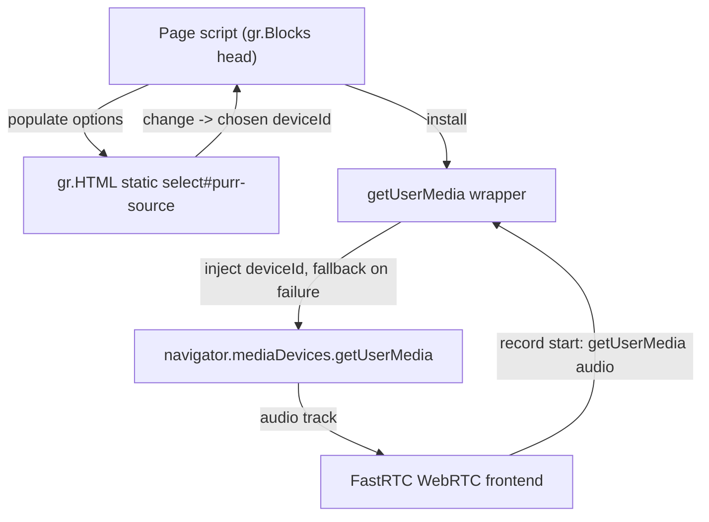

# Separate Microphone-Source Control - Plan

## Goal Capsule

- **Objective:** Replace the CSS restyle of FastRTC's built-in source selector with a separate, labelled microphone-source control in the right rail, and make the chosen device the one the next recording streams from.
- **Product authority:** Decisions come from this brainstorm's Product Contract below. The rest of the PURR UI redesign is already implemented and is not active scope.
- **Supersedes:** the source-picker portion of `docs/plans/2026-09-27-002-refactor-ui-control-rail-layout-plan.md` (R10, R11, unit U3). The rest of that plan stands.
- **Execution profile:** One production file (`app.py`) plus regression coverage in `smoke_test.py`. No dependency or pin changes.
- **Product Contract preservation:** Unchanged except R2 is refined to "remove the restyle, keep a scoped hide rule for FastRTC's own picker" — meaning-preserving, no requirement weakened. The brainstorm's two mechanism questions are resolved as Key Technical Decisions; hint wording and narrow-screen placement remain non-blocking implementation details.
- **Open blockers:** None. The `getUserMedia` wrapper is carried as a risk with a stated fallback.

---

## Product Contract

### Summary

The right rail gains a labelled microphone-source control that lists the visitor's input devices and sets the one the next recording uses. It replaces the current CSS restyle of FastRTC's selector, fills in once microphone permission is granted, and leaves the record button, enhancement selector, and transcript behavior unchanged.

### Problem Frame

The committed UI restyle tried to make FastRTC's built-in source selector read as a separate control by scoped CSS. That cannot work: FastRTC only mounts its `<select>` while the picker is open, so CSS can reposition a transient popup but cannot present an always-visible, separately labelled control. FastRTC also exposes no Python-side device parameter — `track_constraints` is fixed when the component is built, and device discovery lives entirely in its browser code — so a real control has to own the choice in the browser.

### Key Decisions

- **A separate, labelled device control over a distinct trigger for FastRTC's own list.** (session-settled: user-directed — chosen over just re-triggering FastRTC's picker: a real device choice is worth owning.) Governs R1, R2, R5.
- **Choose before recording over live switching.** (session-settled: user-directed — chosen over swapping tracks on an active stream: keeps the control independent of the recording.) Governs R6.
- **Populate after the first permission grant over an up-front permission prompt.** (session-settled: user-directed — chosen over requesting permission on load: avoids an extra step before recording.) Governs R4, R5.

### Requirements

**Placement and appearance**

- R1. The microphone-source control renders in the right control rail as a labelled control, visually distinct from the record button.
- R2. The control replaces the CSS restyle of FastRTC's built-in selector. The restyle rules are removed; a scoped hide rule keeps FastRTC's own picker from conflicting with the new control.
- R3. The record button, the enhancement selector, and the transcript keep their current behavior and placement.

**Device selection**

- R4. Before microphone permission is granted, the control shows a hint state and no device names.
- R5. Once permission is granted, the control lists the available input devices by label, with the browser default pre-selected.
- R6. The device the visitor selects is the one their next recording streams from; the choice does not affect an in-progress recording.
- R7. If the selected device is unavailable when a recording starts, the stream falls back to the browser default rather than failing.

**Preserved behavior**

- R8. Streaming transcription, enhancement-mode selection, error surfacing, the ZeroGPU probe binding, and the `gradio`/`fastrtc` pins are unchanged.

### Key Flows

- F1. First visit, no permission
  - **Trigger:** A visitor loads the page without having granted microphone access.
  - **Steps:** The rail renders the record button and a source control showing a hint state.
  - **Outcome:** The visitor can still start recording; the source control has no device list yet.
  - **Covers:** R1, R4.
- F2. Grant permission and choose a device
  - **Trigger:** The visitor grants microphone access.
  - **Steps:** The control lists the input devices with the default pre-selected; the visitor picks one.
  - **Outcome:** The chosen device is shown as selected.
  - **Covers:** R5.
- F3. Recording uses the chosen device
  - **Trigger:** The visitor starts a new recording after choosing a device.
  - **Steps:** The recording streams audio from the chosen device.
  - **Outcome:** Transcription reflects the chosen input.
  - **Covers:** R6.
- F4. Chosen device disappears
  - **Trigger:** The chosen device is gone when a recording starts.
  - **Steps:** The recording falls back to the browser default.
  - **Outcome:** The recording still starts; no error blocks it.
  - **Covers:** R7.
- F5. Permission denied
  - **Trigger:** The visitor denies microphone access.
  - **Steps:** The record control surfaces the browser/FastRTC error; the source control keeps its hint state.
  - **Outcome:** The visitor can retry without reloading.
  - **Covers:** R4, R8.

### Acceptance Examples

- AE1. Pre-permission state
  - **Given:** the page is loaded with microphone permission not yet granted.
  - **When:** the visitor looks at the rail.
  - **Then:** the source control shows a hint and lists no devices, and the record button still works.
  - **Covers:** R1, R4.
- AE2. Populated after permission
  - **Given:** the visitor has granted microphone access.
  - **When:** they open the source control.
  - **Then:** it lists the available input devices with the browser default selected.
  - **Covers:** R5.
- AE3. Next recording uses the chosen device
  - **Given:** the visitor has more than one input device and selects a non-default one.
  - **When:** they start a recording.
  - **Then:** audio streams from the selected device.
  - **Covers:** R6.
- AE4. In-progress recording is not disturbed
  - **Given:** a recording is in progress.
  - **When:** the visitor changes the source control.
  - **Then:** the current recording keeps its device; the change applies to the next one.
  - **Covers:** R6.
- AE5. Missing device falls back
  - **Given:** the visitor's chosen device is no longer available.
  - **When:** they start a recording.
  - **Then:** the recording starts on the browser default instead of failing.
  - **Covers:** R7.
- AE6. No leftover restyle
  - **Given:** the control ships.
  - **When:** the rail renders.
  - **Then:** FastRTC's built-in arrow/dropdown restyle is gone and the record button reads as a single clean control.
  - **Covers:** R2.
- AE7. Hot-plug refresh
  - **Given:** the page is open with permission granted.
  - **When:** a device is plugged in or removed.
  - **Then:** the source control's list updates without a reload.
  - **Covers:** R5.

### Scope Boundaries

- Deferred for later: switching the device during an active recording; remembering the choice across visits; a microphone level meter.
- Outside this change: enumerating device names before permission (the browser hides them); forking or modifying FastRTC; and the already-shipped layout work.

### Dependencies / Assumptions

- Device selection can only happen in the browser. Gradio and FastRTC expose no Python device parameter, and FastRTC's `track_constraints` is fixed when the component is built, so the control needs a browser-side hook.
- Device labels require microphone permission; before permission, device enumeration returns no usable labels.
- The committed layout (rail, full-height transcript, responsive reflow) stays; this work only replaces the picker.

### Outstanding Questions

- (none blocking) Exact hint wording and the narrow-screen placement of the control within the rail. Deferred to Implementation.

### Sources / Research

- `.venv/Lib/site-packages/fastrtc/webrtc.py` — no device-selection parameter; `track_constraints` is set at construction and replaces FastRTC's audio defaults entirely when passed.
- `.venv/Lib/site-packages/fastrtc/templates/component/index-EQgvOkvr.js` — `Se()` acquires the mic on every recording start with `deviceId` from internal state; `ge()` handles FastRTC's own `<select>` change; the `<select>` mounts only while open; `Se()` rethrows every error except `NotAllowedError`.
- `.venv/Lib/site-packages/gradio/blocks.py` — `head`/`js` accepted in the constructor in 5.50; the frontend injects `head` children as-is so `<script>` executes.
- `docs/plans/2026-09-27-002-refactor-ui-control-rail-layout-plan.md` — the superseded CSS approach.

---

## Planning Contract

### Key Technical Decisions

- KTD1. **Render the source control as a static `<select>` through `gr.HTML` and keep its logic in a page script, not a Gradio `Dropdown`.** Governs R1, R3. Rationale: Python cannot enumerate devices, and the choice only needs to reach browser code, so Gradio's server round-trip and component state are pure overhead. A static `<select>` avoids re-render dropping the listener.
- KTD2. **Inject the script with `gr.Blocks(head=...)`.** Governs R4, R5. Rationale: `gr.HTML` does not execute `<script>` — Svelte assigns it via `innerHTML`, and script elements inserted that way never run. `head` children are recreated and appended by the frontend, so they do. `js=` only accepts a single function, and this script needs a guarded multi-part install. Extend the existing `warnings.filterwarnings` filter to cover the new constructor deprecation warning.
- KTD3. **Bind the chosen device to the next recording with a guarded wrapper on `navigator.mediaDevices.getUserMedia`.** Governs R6, R7. Rationale: FastRTC resolves the device per recording start through `getUserMedia` and never uses `applyConstraints`, so intercepting the call is sufficient. The wrapper applies the chosen device last so it overrides the `deviceId` FastRTC carries from a previous recording, preserves the other audio constraints, and on `OverconstrainedError`/`NotFoundError` retries with the `deviceId` dropped (not the original constraints, which would pin the missing device again). Install once, guarded by a `window` flag because Gradio's dev reload re-injects `head`.
- KTD4. **Hide FastRTC's own source control with a scoped rule, keeping the `purr-webrtc` class as the hook.** Governs R2. Rationale: FastRTC's control is a trigger button plus a `<select>` that mounts only while open; both must be hidden or the rail still shows an extra icon and two pickers can disagree. FastRTC re-derives its internal device from the granted track on each start, so a later start follows the wrapper's choice without FastRTC's selector.
- KTD5. **Populate the source control by enumerating on load, re-enumerating after the first successful permission-bearing `getUserMedia`, and on `devicechange`, preserving the prior choice by `deviceId`.** Governs R4, R5, R7. Rationale: device labels are empty until permission, and hot-plug must refresh the list.
- KTD6. **Add no second `gr.Radio` or `gr.Textbox`, and do not change the stream's inputs or outputs.** Governs R3, R8. Rationale: the smoke test maps components by type and pins the stream wiring.

### High-Level Technical Design

The wrapper sits between FastRTC's audio request and the browser. The picker and the wrapper share a single `chosen` device variable held in the page script.

### Assumptions

- Overriding `navigator.mediaDevices.getUserMedia` shadows the instance method in conforming engines. This is an unsupported monkey-patch, but it is the only mechanism available.
- The Space is served over HTTPS, so `navigator.mediaDevices` exists.
- FastRTC's internal device state re-derives from the granted track each start, so hiding its picker does not strand it.
- The video/combined `getUserMedia` path is left untouched; only `audio` constraints are rewritten.

### Risks & Dependencies

- **Native-method monkey-patch.** The wrapper can interfere with other page code that calls `getUserMedia`. Mitigation: rewrite only audio-only requests, preserve other constraints, and retry cleanly on failure. Fallback if it proves unreliable: revert to FastRTC's own picker.
- **FastRTC internals pin.** The hide rule and the assumed re-derive behavior are tied to `fastrtc==0.0.34`; a bump must re-verify.
- **No browser harness.** Permission, enumeration, chosen-device, and fallback are unverifiable by `smoke_test.py`; they need `ce-test-browser` or manual checks.
- **Dev-reload double injection.** Guard the install with a `window` flag.

### Sequencing

U1 and U2 can land together. U3 depends on U2 (it needs the select's id) and U4 depends on U3. U4 covers the result.

---

## Implementation Units

### U1. Replace the interim picker restyle with a hide rule

- **Goal:** Remove the CSS that tried to restyle FastRTC's selector and hide FastRTC's picker instead.
- **Requirements:** R2, R3; covers AE6
- **Dependencies:** none
- **Files:** `app.py`
- **Approach:** Delete the `.purr-webrtc .select-wrap` restyle rules and the `.purr-webrtc .inset-icon` rule (that arrow belongs to the video picker, not the audio component). Hide both parts of FastRTC's audio source control inside `.purr-webrtc`: the trigger button (`button[aria-label='select input source']`) and its `.select-wrap`. Keep the `purr-webrtc` class as the scope hook.
- **Patterns to follow:** the existing `APP_CSS` `purr-*` class conventions.
- **Test scenarios:** Test expectation: none — CSS removal; verified by the updated smoke assertion in U4 and AE6.
- **Verification:** The record button renders without the injected arrow/dropdown; the `purr-webrtc` class hook remains.

### U2. Add the source control to the rail

- **Goal:** Render a labelled, static device `<select>` in the control rail.
- **Requirements:** R1, R4; realizes F1, covers AE1
- **Dependencies:** none
- **Files:** `app.py`
- **Approach:** Add a `gr.HTML` block inside the rail column, after the enhancement selector, containing a labelled `<select id="purr-source">` with a single hint `<option>` and no device names. Keep the value static — do not update it from Python.
- **Patterns to follow:** the existing static `gr.HTML` header/wave blocks.
- **Test scenarios:** Test expectation: none — static markup; structure asserted in U4.
- **Verification:** The rail shows the labelled control in its hint state; the record button and enhancement selector are unchanged.

### U3. Inject the page script: enumerate, populate, and the device wrapper

- **Goal:** Populate the picker from real devices and make the chosen device bind to the next recording.
- **Requirements:** R4, R5, R6, R7, R8; realizes F2, F3, F4, F5; covers AE2, AE3, AE4, AE5, AE7
- **Dependencies:** U2
- **Files:** `app.py`
- **Approach:**
  - Pass a `head` script to `gr.Blocks`, guarded by a `window` flag against re-injection.
  - Wait for the rendered source control (or delegate its change event on `document`) before attaching the handler and populating it — the `head` script runs at page mount, before Gradio renders the component tree.
  - Enumerate devices on load; fill options after the first successful permission-bearing `getUserMedia`; keep the default selected; re-enumerate on `devicechange`; preserve the prior choice by `deviceId`.
  - Keep a single `chosen` device variable shared by the source control and the wrapper.
  - Install a wrapper on `navigator.mediaDevices.getUserMedia` that, for audio-only requests, applies the chosen `deviceId` last so it overrides the `deviceId` FastRTC carries, and on `OverconstrainedError`/`NotFoundError` retries with the `deviceId` dropped.
  - Extend the module's `warnings.filterwarnings` filter so the new constructor deprecation warning stays silenced.
- **Patterns to follow:** none in the repo — this is the first injected script.
- **Test scenarios** (manual, browser-only; the script's presence is asserted in U4):
  - Covers AE2. Given permission granted, the picker lists device labels with the default selected.
  - Covers AE3. Given a chosen non-default device, the next recording streams from it.
  - Covers AE4. Given a recording in progress, changing the picker leaves that recording on its device.
  - Covers AE5. Given the chosen device is gone, the next recording starts on the default.
  - Covers AE7. Given permission granted, plugging or unplugging a device updates the list.
  - Given permission denied, the picker stays in its hint state and the visitor can retry.
- **Verification:** With permission granted, the picker lists devices; the next recording uses the chosen device; a missing device falls back to the default; hot-plug refreshes the list; an in-progress recording is unaffected.

### U4. Regression coverage

- **Goal:** Guard the structure, the removed restyle, and the wiring without a browser.
- **Requirements:** R2, R3, R8
- **Dependencies:** U1, U2, U3
- **Files:** `smoke_test.py`
- **Approach:** Update the existing assertions tied to the old restyle, and add: the source control exists in the rail; the injected script is present in the app config; FastRTC's own picker is hidden by a scoped rule; still exactly one textbox and one radio; the stream inputs/outputs are unchanged.
- **Patterns to follow:** the existing config-introspection helpers.
- **Test scenarios:**
  - Given the built config, the rail contains the source control.
  - Given the built config, the `head` script is present.
  - Given `app.APP_CSS`, the `.purr-webrtc` hide rule is present and the restyle rules are gone.
  - Given the built config, exactly one textbox and one radio exist.
  - Given the built config, one dependency has both the WebRTC id and the radio id among its inputs, and one has the transcript as its only output.
- **Verification:** `smoke_test.py` passes and fails if the control is dropped from the rail, the script is removed, or the wiring changes.

---

## Verification Contract

- **Smoke test:** run the repo's smoke test with the project interpreter. It asserts import-time purity, the layout and wiring invariants, and U4's new assertions.
- **Static checks:** run the pre-commit hooks (`ruff` annotation rules and the `ty` type checker); both must pass.
- **Browser checks (no harness in CI):** verify AE1–AE7 in a browser with at least two input devices. Use `ce-test-browser` where available. Cover: hint state before permission, labels after permission, chosen device used next, in-progress recording unaffected, missing-device fallback, hot-plug refresh, and the record button reading clean.

## Definition of Done

- All four units are complete; the interim `.purr-webrtc` restyle rules are removed, not orphaned.
- The smoke test and pre-commit hooks pass.
- AE1–AE7 are verified in a browser with real devices.
- The Product Contract is intact except for the recorded refinement of R2.
- No dependency, pin, or `README.md` metadata changes; the ZeroGPU probe binding and the stream wiring are unchanged.
